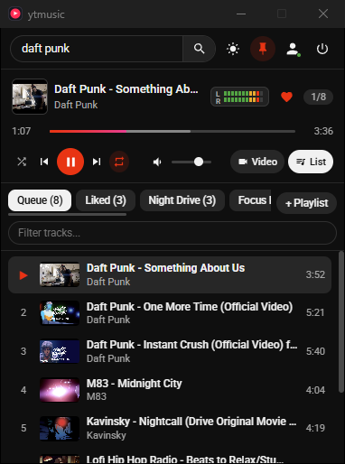
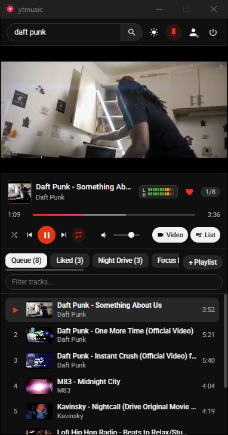
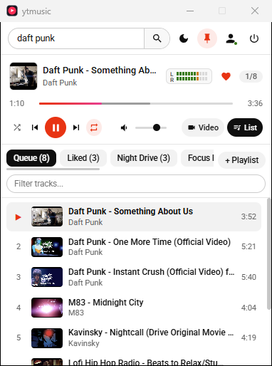
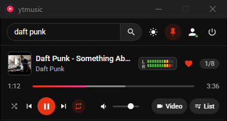
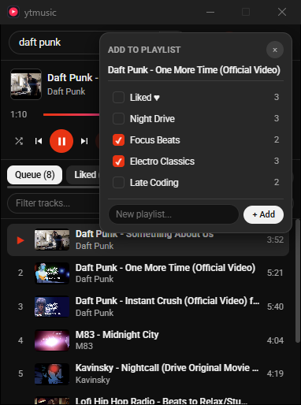
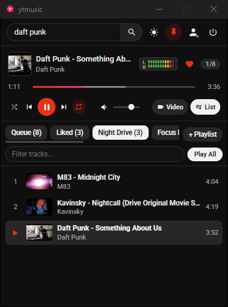
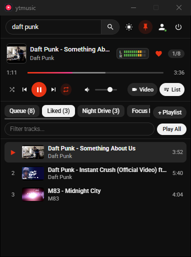
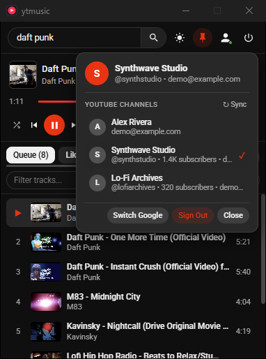

# ytmusic

Minimalistic YouTube music & video player for Windows 11 written in Go and WebView2.

## Features

- **Compact & Expandable UI**: Fixed `380px` width player with audio-only default, collapsible 16:9 video viewport (`V`), collapsible playlist drawer (`L`), Always on Top pin, and YouTube Dark / Light themes (`T`).
- **Playlists & Queue**: Builds 30-song search queues with infinite continuation scroll, shuffle (`S`), repeat (`R`), `Liked ♥`, horizontally scrollable custom playlist tabs, and per-track `+` add-to-playlist menu.
- **Stereo VU Meter**: Live Web Audio `L`/`R` VU & Peak meter in the player deck (click to switch between LED and gradient Bar modes).
- **Google Sign-In & Brand Accounts**: Full Google login with YouTube Brand Account channel selection and instant in-app channel switching.
- **Windows Integration**: Embedded multi-res app icon, system tray minimize/restore animations, tray sleep timer, global media keys, display-sleep-friendly audio playback, and persistent state in `%APPDATA%\ytmusic`.

## Build & Run

```powershell
.\build.ps1 -Test -Run
```

Smoke check without launching the GUI loop:

```powershell
.\bin\ytmusic.exe --smoke-test
```

## Screenshots

| Dark Queue | Video Mode | Light Theme | Compact Mini Player |
| :---: | :---: | :---: | :---: |
|  |  |  |  |

| Add to Playlist | Custom Playlist | Liked Songs | Account & Brand Switcher |
| :---: | :---: | :---: | :---: |
|  |  |  |  |
